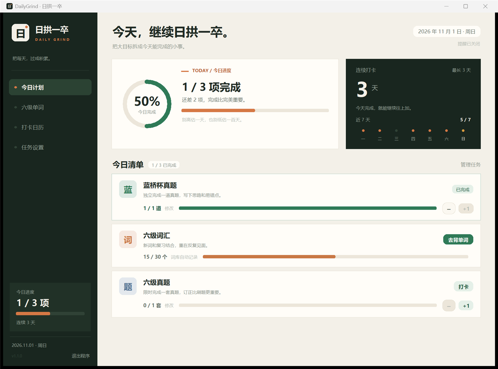
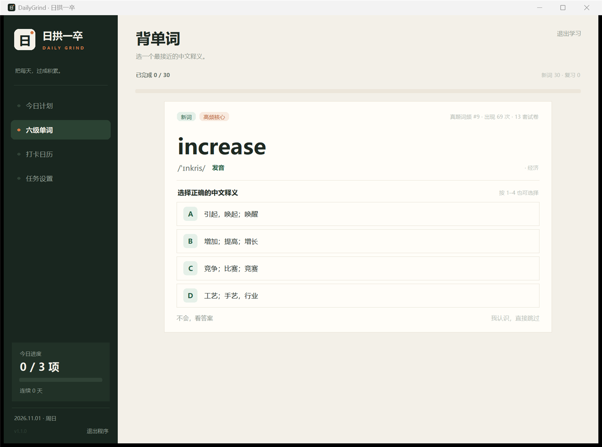

# DailyGrind · 日拱一卒

一个用来督促自己每天完成固定练习的 Windows 桌面小工具。默认内置三项任务：**一道蓝桥杯真题、30 个六级词汇、一套六级真题**，也可以改成你自己的每日计划。

六级词汇不只是一个数字任务：它内置了按 2020–2025 年六级真题词频整理的词库，采用类似百词斩的「单词 → 四个释义选项 → 订正 → 间隔复习」流程。所有数据只保存在本机。





> 截图使用演示数据。

## 功能

- **每日任务**：自定义任务名称、目标数量和单位，例如「每天 1 道题」「每天 30 个单词」。
- **数量进度**：普通任务可按步长增加或减少，也可以点击「修改」输入精确数量。
- **自动打卡**：当天所有任务都达到目标后，自动记入连续打卡。
- **连续天数**：今日尚未完成时，不会提前中断昨天以前形成的连续记录。
- **打卡日历**：按月查看全部完成日期、有记录日期、累计全勤数和近 7 天完成率。
- **六级单词训练**：按真题词频每天发词，四选一释义、发音、例句、中文解析、错词复习。
- **间隔复习**：答错的词次日再出现；答对的词按间隔逐渐拉长；选择「我认识」的词不再作为新词出现。
- **到点提醒**：默认每天 20:30 检查，若任务未完成会弹出置顶提醒，可以稍后提醒 10 分钟。
- **开机自启**：可选。使用当前用户的 Windows 启动项，关闭后不会留下配置。
- **本地优先**：标准库实现，不需要注册账号，不依赖第三方 Python 包。

## 快速开始

### 方式一：双击启动

双击项目根目录的 **`DailyGrind.bat`**。

### 方式二：命令行启动

```bat
python app.py
```

首次启动会在 `data/` 下创建数据库，并写入三项默认任务：

| 任务 | 每日目标 | 说明 |
|---|---:|---|
| 蓝桥杯真题 | 1 道 | 手动记录 |
| 六级词汇 | 30 个 | 内置词库自动记录 |
| 六级真题 | 1 套 | 手动记录 |

可以直接在「任务设置」里修改目标、每次增减的数量，或者添加新任务。

## 六级单词怎么用

点击侧边栏的「六级单词」，或点今日任务「六级词汇」的「去背单词」。

- 每天的学习量默认是 **30 个**，由「六级词汇」这个内置任务的目标决定，可以在「任务设置」中修改。
- 当天计划优先放入**到期复习词**，剩余数量用**新词**补足。
- 每个词先看到英文和音标，从四个中文释义中选择；答完会显示完整释义、例句和下次复习时间。
- 答错：明天再考一次。
- 答对：复习间隔会逐渐拉长。
- 如果已经认识，点「我认识，直接跳过」，这个词不再作为新词出现，只会在掌握列表中保留。
- 「发音」使用 Windows 本地语音，不需要联网。
- 今天的训练完成后，「六级词汇」任务会自动打卡，参与当天的连续打卡结算。

内置词库现在包含约 **1,813 个词**：

- **166 个精炼核心词**：按六级真题高频价值整理，带中文释义和常见搭配，优先出现。
- **1,647 个真题词**：在 2020–2025 年 35 套六级真题中出现过，按真题词频排序，并补充音标、释义和例句。

词库不是官方考纲，释义和例句来自开源词典数据，个别词的义项可能不完整；它更适合用来做高频词复习，而不是替代系统词书。

## 每天怎么用

1. 打开「今日计划」。
2. 先打开「六级单词」完成当天单词；答错的词会在之后自动复习。
3. 其他任务完成后点 `+` 记录数量，或点「打卡」直接完成。
4. 当天全部任务完成后自动收工，并记入连续打卡。
5. 需要调整任务或提醒时间，去「任务设置」。

连续打卡只统计**当天所有任务都完成**的日期。今天还没完成时，昨天的连续记录会保留到当天结束。

## 提醒说明

提醒默认开启，时间为 **20:30**，可以在「任务设置 → 每日提醒」中修改。

- 提醒窗口弹出时，选择「10 分钟后再提醒」会暂时关闭提醒；直接点窗口关闭按钮也视为稍后提醒。
- 选择「现在去完成」后，当天不再提醒，方便你专心做事。
- **DailyGrind 必须保持运行，提醒才会生效。**
- 如果希望登录 Windows 后自动在后台待命，可以在设置里打开「开机自启」。它只会写入当前用户的注册表启动项：

  ```text
  HKCU\Software\Microsoft\Windows\CurrentVersion\Run
  ```

  关闭开关会删除该项，不需要管理员权限。

关闭窗口时，如果当天还有任务未完成，程序会询问「最小化继续提醒」还是「直接退出」。

## 数据与备份

数据文件：

```text
data/dailygrind.db
```

备份时退出程序，然后复制这个文件即可。数据库里保存任务、每日数量、全勤日期、单词学习记录、复习计划、词频计划和提醒设置。删除 `data/` 会重置为初始状态。

## 环境要求

- Windows 10/11
- Python **3.11 或更高版本**（带 Tkinter）
- 不需要 `pip install`

检查环境：

```bat
python -c "import tkinter, sqlite3; print('OK')"
```

## 运行测试

```bat
python -m unittest discover -s tests -v
```

测试覆盖进度计算、四舍五入、连续天数、提醒策略、SQLite 数据层、词库调度、间隔复习、单词训练界面和普通页面冒烟测试，共 50 项。

## 项目结构

```text
DailyGrind/
├─ app.py                     # 程序入口、DPI 适配、单实例、异常日志
├─ DailyGrind.bat             # 双击启动，用 pythonw 隐藏控制台
├─ assets/                    # 应用图标和 README 截图
├─ dailygrind/
│  ├─ models.py               # 任务、进度、连续天数等纯逻辑
│  ├─ store.py                # SQLite、任务、单词计划和复习记录
│  ├─ vocab.py                # 词库加载、例句、每日计划和间隔复习
│  ├─ reminders.py            # 提醒时间、稍后提醒策略
│  ├─ startup.py              # 当前用户的 Windows 开机自启
│  ├─ tts.py                  # Windows 本地英文发音
│  ├─ paths.py                # 路径和常量
│  ├─ worddata/
│  │  └─ cet6_words.json      # 内置六级词库
│  └─ ui/                     # 主题、自定义控件、页面和弹窗
├─ tests/                     # 单元测试和界面冒烟测试
├─ data/                      # 运行时生成，不提交
├─ THIRD_PARTY_NOTICES.md     # 词库来源和许可证全文
└─ README.md
```

架构上，业务规则、数据持久化和 Tkinter 界面相互分离：`models.py` 不依赖界面或数据库，`store.py` 不弹窗口，页面通过主窗口调用数据层和服务层。

## 隐私

这个工具不访问网络，不上传数据，不收集统计。发音使用 Windows 本地语音。所有日志写入本地的 `data/dailygrind.log`。

## 词库来源

- [wangjiuyi543-ui/cet6-vocabulary](https://github.com/wangjiuyi543-ui/cet6-vocabulary)：MIT，2020–2025 年 35 套六级真题词频和精炼核心词。
- [KyleBing/english-vocabulary](https://github.com/KyleBing/english-vocabulary)：BSD-3-Clause，中文释义、音标和例句。
- 完整许可证和修改说明见 [THIRD_PARTY_NOTICES.md](THIRD_PARTY_NOTICES.md)。
